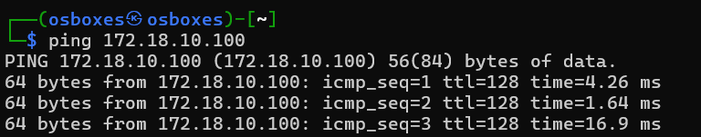
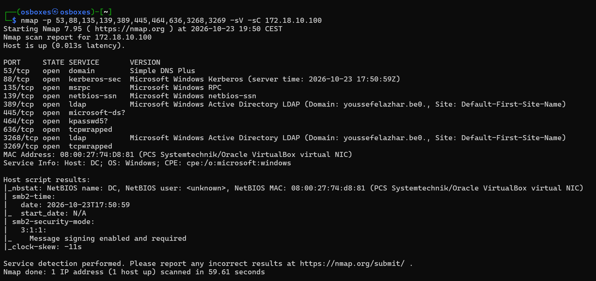
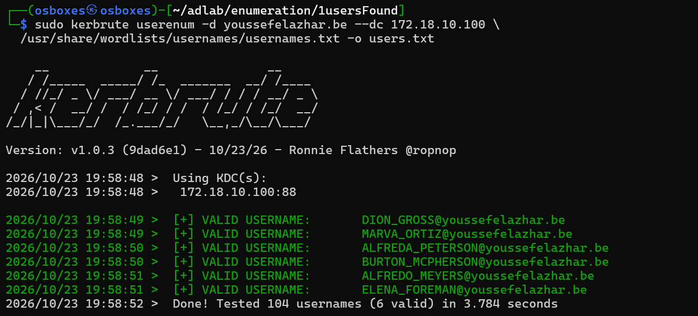

# 01 — Recon & enumeration

## Context
Starting from the attacker machine (KALI, `172.18.10.105`) with no credentials, the goal is to
confirm the target is reachable, identify what it runs, and build a list of valid domain accounts.

## Prerequisites
- Access: network access to the lab, no credentials
- Tools: `ping`, `nmap`, `kerbrute`

## Walkthrough

1. Confirm the domain controller is up.
   ```bash
   ping 172.18.10.100
   ```
   The host answers with TTL 128, which already hints at Windows.
   

2. Scan the common AD service ports with version and default-script detection.
   ```bash
   nmap -p 53,88,135,139,389,445,464,636,3268,3269 -sV -sC 172.18.10.100
   ```
   The result is a textbook domain controller: DNS (53), Kerberos (88), RPC (135), NetBIOS (139),
   LDAP (389) and Global Catalog (3268), plus `kpasswd` (464) and LDAPS (636/3269). The LDAP banner
   leaks the domain name, `youssefelazhar.be`, and the host identifies itself as `DC`. SMB signing
   is enabled and required.
   

3. Enumerate valid usernames against the KDC with `kerbrute`. This is pre-auth username guessing: it
   asks the KDC about each name and watches how it responds, so it never needs a password and does
   not show up as a failed logon.
   ```bash
   sudo kerbrute userenum -d youssefelazhar.be --dc 172.18.10.100 \
     /usr/share/wordlists/usernames/usernames.txt -o users.txt
   ```
   Out of 104 names tested, 6 come back valid:
   ```
   [+] VALID USERNAME:  DION_GROSS@youssefelazhar.be
   [+] VALID USERNAME:  MARVA_ORTIZ@youssefelazhar.be
   [+] VALID USERNAME:  ALFREDA_PETERSON@youssefelazhar.be
   [+] VALID USERNAME:  BURTON_MCPHERSON@youssefelazhar.be
   [+] VALID USERNAME:  ALFREDO_MEYERS@youssefelazhar.be
   [+] VALID USERNAME:  ELENA_FOREMAN@youssefelazhar.be
   Done! Tested 104 usernames (6 valid) in 3.784 seconds
   ```
   

## Why it works
Kerberos answers an authentication-service request differently for a name that exists and one that
does not: a non-existent principal gets `KDC_ERR_C_PRINCIPAL_UNKNOWN`, while a real one gets a
pre-auth challenge. `kerbrute` reads that difference to confirm accounts without ever trying a
password, which keeps the noise down. The nmap banners leak the domain name and services for free
because they are meant to be reachable on the network.

## Impact
The attacker now has the domain name, the DC's role and service list, and a confirmed list of six
valid accounts. That is the raw material for every credential attack that follows (AS-REP Roasting,
password spraying, Kerberoasting).

## Remediation
- Username enumeration over Kerberos is hard to switch off outright, but you can blunt it: keep
  account naming unpredictable and monitor for bursts of `KDC_ERR_C_PRINCIPAL_UNKNOWN` /
  pre-auth events (Event ID `4768`) from a single source.
- Restrict who can reach the DC's management and LDAP ports with host/network firewalling, so a box
  like KALI has no business talking to them in the first place.
- *(to apply)* Alerting rule on the DC: flag more than N distinct account lookups from one host
  inside a short window.

## Verification
*(to apply)* Re-run `kerbrute userenum` from KALI after the network restrictions are in place and
confirm the KDC is no longer reachable from the attacker subnet (connection refused / filtered),
and that the enumeration attempt shows up in the DC's security log.

## Reference
- MITRE ATT&CK — T1087.002, Account Discovery: Domain Account
- MITRE ATT&CK — T1046, Network Service Discovery
